

<picture>
<source media="(max-width: 600px)" srcset="assets/hero/banner-mobile.png">
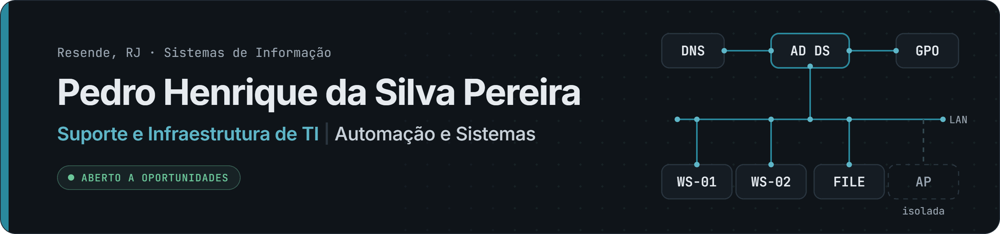
</picture>
 

<a href="https://pedro-osaka.github.io/portfolio/assets/curriculo-pedro-henrique.pdf">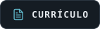</a>

 
<picture>
<source media="(max-width: 600px)" srcset="assets/hero/perfil-mobile.svg">
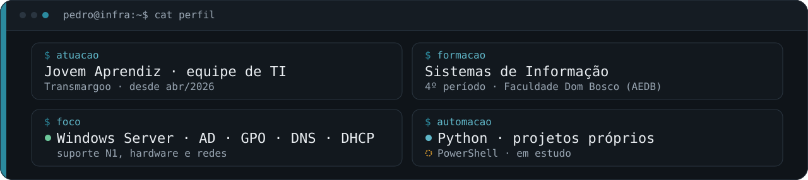
</picture>

<b>Sobre mim</b>

 

Comecei no suporte dos laboratórios de informática da faculdade: formatação, drivers, periféricos, cabeamento e atendimento a alunos e professores. Hoje, na equipe de TI de uma empresa de transporte, cuido do dia a dia das estações e dos usuários. Já retomei um servidor Windows Server após uma queda de energia, corrigi um conflito de IP entre roteador e gateway e isolei o Wi-Fi de visitantes da rede interna.

Quando um problema se repete, escrevo uma ferramenta em Python para resolvê-lo; em PowerShell, faço scripts de apoio enquanto estudo a linguagem. Cada projeto aqui documenta o problema, os testes e as limitações, e o status é sempre declarado: o que está em andamento aparece como **WIP** ou **em documentação**, nunca como concluído.

## Tech Stack

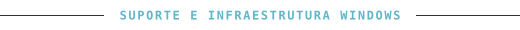
 
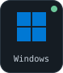&nbsp;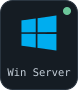&nbsp;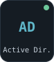&nbsp;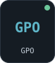&nbsp;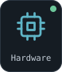&nbsp;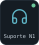
  
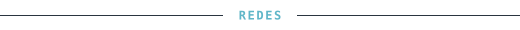
 
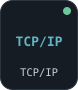&nbsp;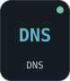&nbsp;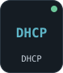&nbsp;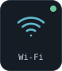&nbsp;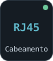
  
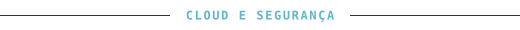
 
&nbsp;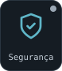&nbsp;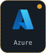
  
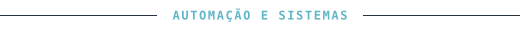
 
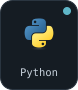&nbsp;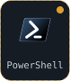&nbsp;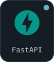&nbsp;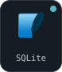&nbsp;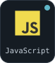&nbsp;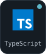&nbsp;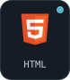&nbsp;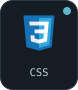&nbsp;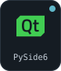&nbsp;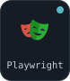&nbsp;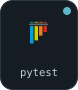
  
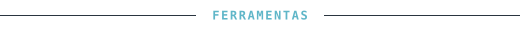
 
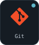&nbsp;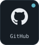&nbsp;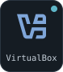
  

Uso profissional: no trabalho. Projetos próprios: nos repositórios abaixo. Fundamentos: curso concluído (AWS Academy, Cisco). Em estudo: sem uso comprovado ainda. Sem barras de porcentagem.

## GitHub Analytics

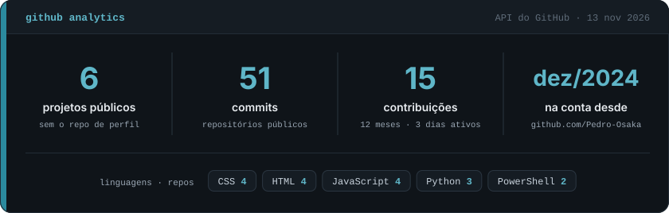

<!-- stats:start -->
Em texto: **6** projetos públicos · **52** commits nos repositórios públicos · **15** contribuições em **3** dias nos últimos 12 meses · conta criada em dez/2024. Linguagens (nº de repositórios): CSS (4) · HTML (4) · JavaScript (4) · Python (3) · PowerShell (2). Gerado pela API do GitHub em 13 nov 2026.
<!-- stats:end -->

Atualizado toda semana por uma GitHub Action com [`brand/stats.py`](brand/stats.py), sem serviço externo. O calendário de contribuições é o do próprio GitHub, logo abaixo deste README.

## Projetos em destaque

<table>
<tr>
<td width="50%" valign="top">

 
 <b><a href="https://github.com/Pedro-Osaka/kaizen-tech">Kaizen Tech</a></b> · Python · Tkinter · PowerShell
 Utilitário de manutenção para técnicos de suporte: diagnóstico, ponto de restauração, limpeza com confirmação e relatório do atendimento em PDF. 14 testes.
</td>
<td width="50%" valign="top">
<a href="https://github.com/Pedro-Osaka/lab-active-directory">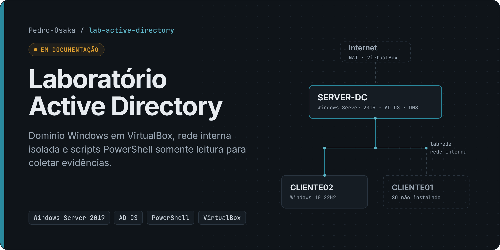</a>
 
 <b><a href="https://github.com/Pedro-Osaka/lab-active-directory">Laboratório Active Directory</a></b> · Windows Server 2019 · AD DS · DNS
 Domínio em VirtualBox com cliente Windows 10 em rede isolada e scripts PowerShell somente leitura para coletar evidências. As evidências ainda não foram coletadas.
</td>
</tr>
<tr>
<td width="50%" valign="top">

 
 <b><a href="https://github.com/Pedro-Osaka/fleet-report-demo">Fleet Report Demo</a></b> · FastAPI · SQLite · pytest
 Importação conferida de planilhas e relatórios diários em XLSX e PDF. 20 testes, dados 100% fictícios.
</td>
<td width="50%" valign="top">
<a href="https://github.com/Pedro-Osaka/inclusao-360">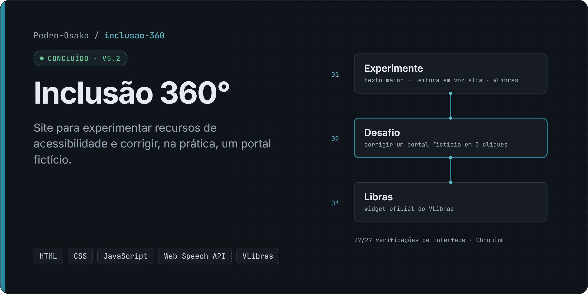</a>
 
 <b><a href="https://github.com/Pedro-Osaka/inclusao-360">Inclusão 360°</a></b> · <a href="https://pedro-osaka.github.io/inclusao-360/">demo ao vivo</a>
 Site para experimentar recursos de acessibilidade, com leitura em voz alta, VLibras e um desafio de correção. Projeto individual, v5.2.
</td>
</tr>
<tr>
<td width="50%" valign="top">
<a href="https://github.com/Pedro-Osaka/campus-ai">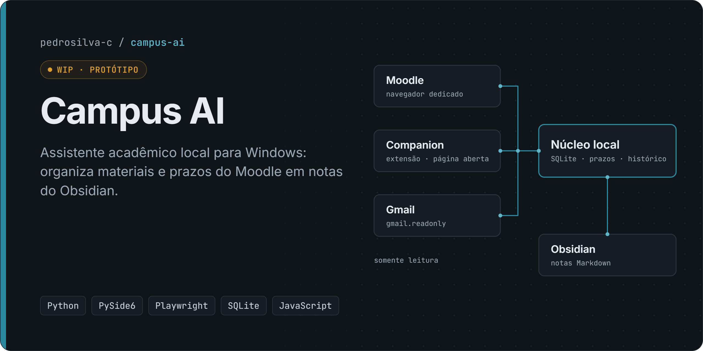</a>
 
 <b><a href="https://github.com/Pedro-Osaka/campus-ai">Campus AI</a></b> · Python · PySide6 · Playwright
 Assistente acadêmico local que organiza materiais e prazos do Moodle no Obsidian. Protótipo, ainda não validado com contas reais. 566 testes Python e 97 da extensão.
</td>
<td width="50%" valign="top">
<a href="https://github.com/Pedro-Osaka/portfolio">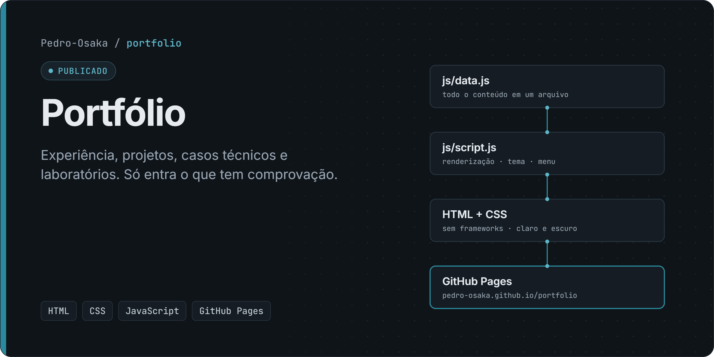</a>
 
 <b><a href="https://github.com/Pedro-Osaka/portfolio">Portfólio</a></b> · <a href="https://pedro-osaka.github.io/portfolio/">site</a>
 Experiência, casos técnicos e laboratórios. HTML, CSS e JavaScript sem frameworks, publicado no GitHub Pages.
</td>
</tr>
</table>

Também participei do **[BarberFlow](https://pedro-osaka.github.io/portfolio/#projeto-barberflow)**, Projeto Integrador em grupo de 7 integrantes (requisitos, UML e arquitetura planejada em AWS).

## Certificações

<a href="https://www.credly.com/go/B36iQJ1m">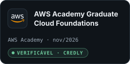</a>&nbsp;
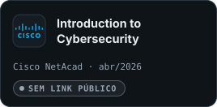&nbsp;
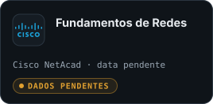

Nome oficial, data e link de verificação de "Fundamentos de Redes" aguardam o comprovante da Cisco.

## Experiência e formação

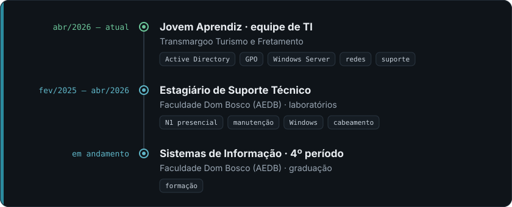

<b>Atividades em detalhe</b>

 

**Jovem Aprendiz, equipe de TI** · Transmargoo Turismo e Fretamento · `abr/2026 – atual` 
Atendimento a usuários e manutenção de estações Windows, impressoras e conectividade. Participo da gestão de usuários e permissões no Active Directory e em GPOs. Retomei um servidor Windows Server após queda de energia, corrigi um conflito de IP e isolei o Wi-Fi de visitantes da rede interna.

**Estagiário de Suporte Técnico** · Faculdade Dom Bosco (AEDB) · `fev/2025 – abr/2026` 
Atendimento N1 presencial; manutenção preventiva e corretiva nos laboratórios de informática; instalação de Windows, drivers e periféricos; cabeamento e crimpagem; participação na implantação de um laboratório.

**Sistemas de Informação** · Faculdade Dom Bosco (AEDB) · `4º período, em andamento`

 

Uso assistentes de IA (Claude Code, Codex) no desenvolvimento; as decisões, os testes e a revisão são meus. · Visual gerado a partir de <a href="brand/">brand/</a>, sem serviços externos.

