

<picture>
<source media="(max-width: 600px)" srcset="assets/hero/banner-mobile.png">

</picture>
 

 
<picture>
<source media="(max-width: 600px)" srcset="assets/hero/perfil-mobile.svg">

</picture>

<b>Sobre mim</b>

 

Comecei no suporte dos laboratórios de informática da faculdade: formatação, drivers, periféricos, cabeamento e atendimento a alunos e professores. Hoje, na equipe de TI de uma empresa de transporte, cuido do dia a dia das estações e dos usuários. Já retomei um servidor Windows Server após uma queda de energia, corrigi um conflito de IP entre roteador e gateway e isolei o Wi-Fi de visitantes da rede interna.

Quando um problema se repete, escrevo uma ferramenta em Python para resolvê-lo; em PowerShell, faço scripts de apoio enquanto estudo a linguagem. Cada projeto aqui documenta o problema, os testes e as limitações, e o status é sempre declarado: o que está em andamento aparece como **WIP** ou **em documentação**, nunca como concluído.

## Tech Stack

<picture>
<source media="(max-width: 600px)" srcset="assets/sections/stack-mobile.svg">

</picture>

**Uso profissional:** no trabalho. **Projetos próprios:** nos repositórios abaixo. **Fundamentos:** curso concluído (AWS Academy, Cisco). **Em estudo:** sem uso comprovado ainda.

## GitHub Analytics

<picture>
<source media="(max-width: 600px)" srcset="assets/sections/analytics-mobile.svg">
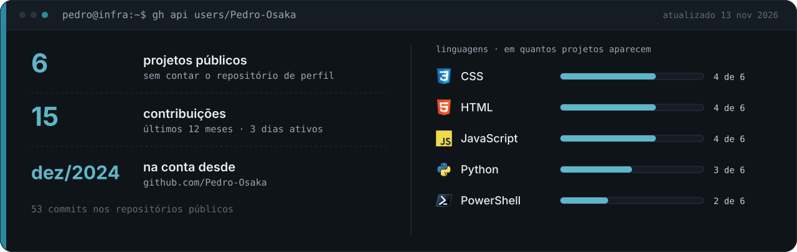
</picture>

<!-- stats:start -->
Em texto: **6** projetos públicos · **54** commits nos repositórios públicos · **15** contribuições em **3** dias nos últimos 12 meses · conta criada em dez/2024. Linguagens (nº de repositórios): CSS (4) · HTML (4) · JavaScript (4) · Python (3) · PowerShell (2). Gerado pela API do GitHub em 13 nov 2026.
<!-- stats:end -->

Atualizado toda segunda-feira por uma GitHub Action com [`brand/stats.py`](brand/stats.py), direto da API do GitHub. O calendário de contribuições é o nativo, logo abaixo deste README.

## Projetos em destaque

<picture>
<source media="(max-width: 600px)" srcset="assets/sections/status-legend-mobile.svg">

</picture>

<a href="https://github.com/Pedro-Osaka/kaizen-tech"><picture>
<source media="(max-width: 600px)" srcset="assets/sections/project-kaizen-tech-mobile.svg">
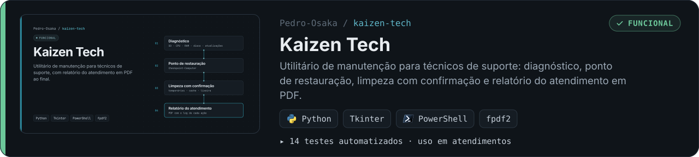
</picture></a>
Kaizen Tech: <a href="https://github.com/Pedro-Osaka/kaizen-tech">Repositório</a>

<a href="https://github.com/Pedro-Osaka/lab-active-directory"><picture>
<source media="(max-width: 600px)" srcset="assets/sections/project-lab-active-directory-mobile.svg">
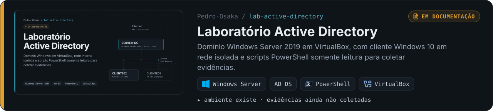
</picture></a>
Laboratório Active Directory: <a href="https://github.com/Pedro-Osaka/lab-active-directory">Repositório</a>

<a href="https://github.com/Pedro-Osaka/fleet-report-demo"><picture>
<source media="(max-width: 600px)" srcset="assets/sections/project-fleet-report-demo-mobile.svg">
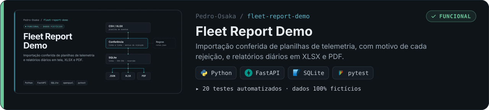
</picture></a>
Fleet Report Demo: <a href="https://github.com/Pedro-Osaka/fleet-report-demo">Repositório</a>

<a href="https://github.com/Pedro-Osaka/inclusao-360"><picture>
<source media="(max-width: 600px)" srcset="assets/sections/project-inclusao-360-mobile.svg">
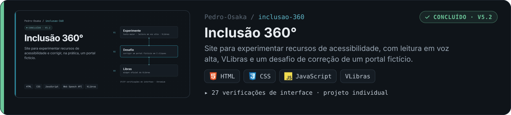
</picture></a>
Inclusão 360°: <a href="https://github.com/Pedro-Osaka/inclusao-360">Repositório</a> · <a href="https://pedro-osaka.github.io/inclusao-360/">Demo ao vivo</a>

<a href="https://github.com/Pedro-Osaka/campus-ai"><picture>
<source media="(max-width: 600px)" srcset="assets/sections/project-campus-ai-mobile.svg">
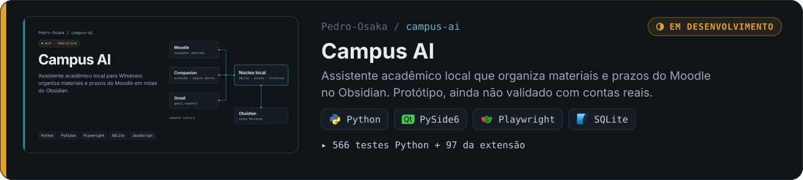
</picture></a>
Campus AI: <a href="https://github.com/Pedro-Osaka/campus-ai">Repositório</a>

<a href="https://github.com/Pedro-Osaka/portfolio"><picture>
<source media="(max-width: 600px)" srcset="assets/sections/project-portfolio-mobile.svg">
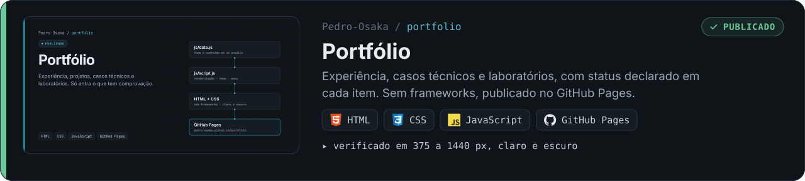
</picture></a>
Portfólio: <a href="https://github.com/Pedro-Osaka/portfolio">Repositório</a> · <a href="https://pedro-osaka.github.io/portfolio/">Site publicado</a>

Também participei do **[BarberFlow](https://pedro-osaka.github.io/portfolio/#projeto-barberflow)**, Projeto Integrador em grupo de 7 integrantes (requisitos, UML e arquitetura planejada em AWS).

## Certificações

<a href="https://www.credly.com/go/B36iQJ1m">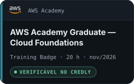</a>&nbsp;
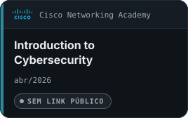&nbsp;
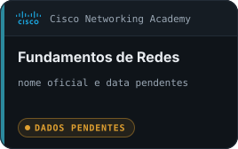

Nome oficial, data e link de verificação de "Fundamentos de Redes" aguardam o comprovante da Cisco.

## Experiência e formação

<picture>
<source media="(max-width: 600px)" srcset="assets/sections/experience-mobile.svg">
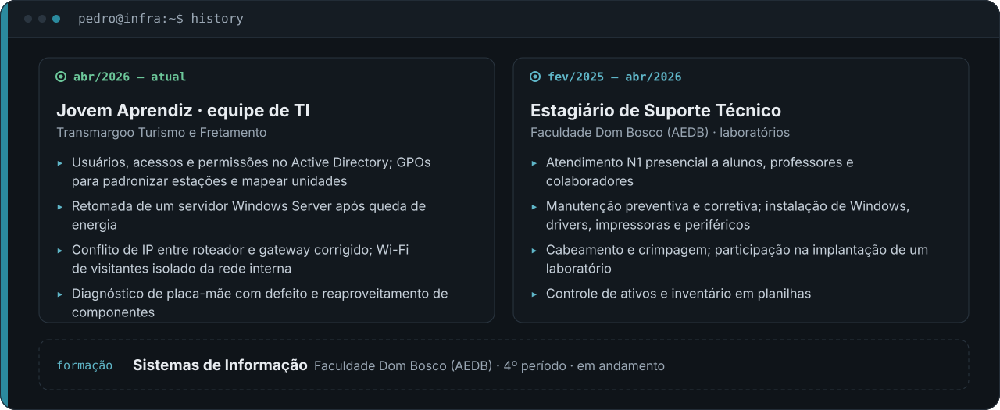
</picture>

<b>Atividades em detalhe</b>

 

**Jovem Aprendiz, equipe de TI** · Transmargoo Turismo e Fretamento · `abr/2026 – atual` 
Atendimento a usuários e manutenção de estações Windows, impressoras e conectividade. Participo da gestão de usuários e permissões no Active Directory e em GPOs. Retomei um servidor Windows Server após queda de energia, corrigi um conflito de IP e isolei o Wi-Fi de visitantes da rede interna.

**Estagiário de Suporte Técnico** · Faculdade Dom Bosco (AEDB) · `fev/2025 – abr/2026` 
Atendimento N1 presencial; manutenção preventiva e corretiva nos laboratórios de informática; instalação de Windows, drivers e periféricos; cabeamento e crimpagem; participação na implantação de um laboratório.

**Sistemas de Informação** · Faculdade Dom Bosco (AEDB) · `4º período, em andamento`

 

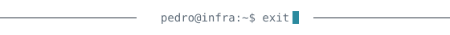 
Visual e estatísticas gerados em <a href="brand/">brand/</a>, sem serviços externos. Uso assistentes de IA (Claude Code, Codex) no desenvolvimento; as decisões, os testes e a revisão são meus.

