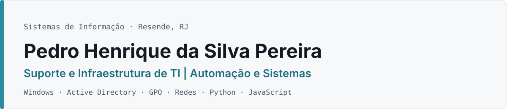

<picture>
  <source media="(prefers-color-scheme: dark)" srcset="assets/banner-dark.svg">
  
</picture>

Sou estudante de **Sistemas de Informação** (4º período, Faculdade Dom Bosco — AEDB) e trabalho no **suporte e na infraestrutura de TI** de uma empresa de transporte. Em paralelo, desenvolvo ferramentas em **Python e JavaScript** para automatizar problemas que encontro no dia a dia. Cada uma tem testes, documentação e limitações declaradas.

[Portfólio](https://pedrosilva-c.github.io/portfolio/) · [LinkedIn](https://www.linkedin.com/in/pedrosilva-sistemas/) · [contatopedromarketinglab@gmail.com](mailto:contatopedromarketinglab@gmail.com) · [Currículo (PDF)](https://pedrosilva-c.github.io/portfolio/assets/curriculo-pedro-henrique.pdf)

---

### Experiência

| Período | Função | O que faço |
|---|---|---|
| abr/2026 — atual | **Jovem Aprendiz, equipe de TI** · Transmargoo Turismo e Fretamento | Atendimento a usuários e manutenção de estações Windows; participação na gestão de usuários e permissões no Active Directory e em GPOs; retomada de servidor Windows Server após queda de energia; correção de conflito de IP; Wi-Fi de visitantes isolado da rede interna |
| fev/2025 — abr/2026 | **Estagiário de Suporte Técnico** · Faculdade Dom Bosco (AEDB) | Manutenção preventiva e corretiva nos laboratórios de informática, instalação de Windows, drivers e periféricos, cabeamento e atendimento a alunos e professores |

### Projetos

| Projeto | Área | Estado | Resumo |
|---|---|---|---|
| [**Campus AI**](https://github.com/pedrosilva-c/campus-ai) | Automação · Python | `WIP` | Assistente acadêmico para Windows: organiza materiais e prazos do Moodle em notas do Obsidian. PySide6, Playwright, SQLite e extensão de navegador. 566 testes Python e 97 da extensão |
| [**Kaizen Tech**](https://github.com/pedrosilva-c/kaizen-tech) | Suporte · Windows | `funcional` | Utilitário de manutenção para técnicos: diagnóstico, limpeza com confirmação, ponto de restauração e relatório do atendimento em PDF. Limpeza que não segue links ou junções |
| [**Fleet Report Demo**](https://github.com/pedrosilva-c/fleet-report-demo) | Sistemas · Python | `funcional` | Importação conferida de planilhas de telemetria e relatórios diários em XLSX e PDF. FastAPI, SQLite, 19 testes. Dados 100% fictícios |
| [**Inclusão 360°**](https://github.com/pedrosilva-c/inclusao-360) · [demo](https://pedrosilva-c.github.io/inclusao-360/) | Web · Acessibilidade | `concluído` | Demonstração prática de acessibilidade digital com leitura em voz alta, VLibras e um desafio de correção |
| [**Laboratório AD**](https://github.com/pedrosilva-c/lab-active-directory) | Infraestrutura | `em documentação` | Domínio Active Directory em VirtualBox (Windows Server 2019 + Windows 10, rede isolada) com scripts PowerShell somente leitura para coletar evidências |
| [**BarberFlow**](https://pedrosilva-c.github.io/portfolio/#projeto-barberflow) | Acadêmico · em grupo | `especificação` | Projeto Integrador de 7 integrantes: requisitos, UML e arquitetura planejada em AWS |

### Tecnologias

**Uso em ambiente corporativo:** suporte técnico e hardware · Windows e Windows Server · Active Directory · GPO · TCP/IP, DHCP, DNS e Wi-Fi

**Uso em projetos próprios:** Python (PySide6, Tkinter, Playwright) · FastAPI · SQLite · JavaScript, TypeScript e React · testes com unittest e pytest

**Fundamentos e estudo:** AWS (AWS Academy) · cibersegurança (Cisco) · PowerShell · Microsoft Azure

### Certificações

- **AWS Academy Graduate — Cloud Foundations** · AWS Academy · nov/2026 · [verificar](https://www.credly.com/go/B36iQJ1m)
- **Introduction to Cybersecurity** · Cisco Networking Academy · abr/2026
- **Fundamentos de Redes** · Cisco Networking Academy

Uso assistentes de IA (Claude Code, Codex) no desenvolvimento. As decisões, os testes e a revisão são meus.
