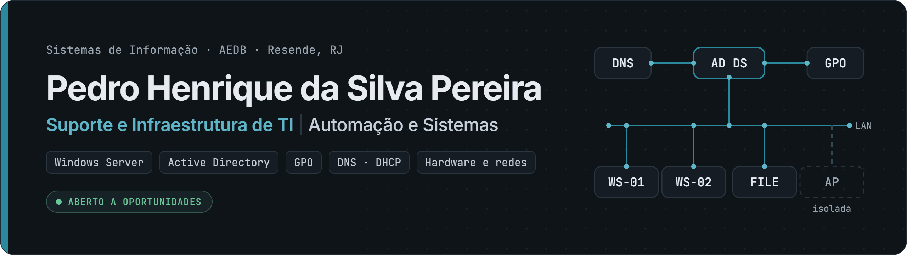

### Suporte e Infraestrutura de TI · Automação e Sistemas

Trabalho no **suporte e na infraestrutura de TI** de uma empresa de transporte e curso **Sistemas de Informação** (4º período) na Faculdade Dom Bosco (AEDB). Atendo usuários, mantenho estações Windows e participo da gestão do Active Directory, das GPOs e da rede.

## Sobre mim

Comecei no suporte dos laboratórios de informática da faculdade: formatação, drivers, periféricos, cabeamento e atendimento a alunos e professores. Hoje, na equipe de TI de uma empresa, cuido do dia a dia das estações e dos usuários. Já retomei um servidor Windows Server após uma queda de energia, corrigi um conflito de IP entre roteador e gateway e isolei o Wi-Fi de visitantes da rede interna.

Quando um problema se repete, escrevo uma ferramenta em Python ou PowerShell para resolvê-lo. Cada projeto aqui documenta o problema, os testes e as limitações, e o status é sempre declarado: o que está em andamento aparece como **WIP** ou **em documentação**, nunca como concluído.

## Conecte-se comigo

| Canal | Endereço |
|---|---|
| **Portfólio** | [pedro-osaka.github.io/portfolio](https://pedro-osaka.github.io/portfolio/) |
| **LinkedIn** | [in/pedrosilva-sistemas](https://www.linkedin.com/in/pedrosilva-sistemas/) |
| **E-mail** | [contatopedromarketinglab@gmail.com](mailto:contatopedromarketinglab@gmail.com) |
| **Currículo** | [PDF, 1 página](https://pedro-osaka.github.io/portfolio/assets/curriculo-pedro-henrique.pdf) |

## Tecnologias e competências

| Área e nível | Competências |
|---|---|
| **Suporte técnico** uso profissional | Atendimento N1 a usuários · Windows 10/11 · instalação de sistema, drivers, impressoras e periféricos · manutenção e diagnóstico de hardware |
| **Infraestrutura Windows** uso profissional | Windows Server · Active Directory (usuários, acessos e permissões) · GPO (padronização de estações e mapeamento de unidades) · [laboratório próprio](https://github.com/Pedro-Osaka/lab-active-directory) em VirtualBox |
| **Redes** uso profissional | TCP/IP · DNS · DHCP · diagnóstico de conflito de IP · Wi-Fi de visitantes isolado · cabeamento e crimpagem |
| **Cloud** fundamentos · em estudo | AWS: Cloud Foundations (curso concluído) · Microsoft Azure: fundamentos (em estudo, sem projeto publicado) |
| **Cibersegurança** fundamentos | Introduction to Cybersecurity (Cisco, curso concluído): ameaças, proteção de dispositivos e redes |
| **Automação e sistemas** projetos próprios | Python (Tkinter, PySide6, Playwright) · FastAPI · SQLite · JavaScript e TypeScript · testes com pytest e unittest · Git e GitHub |
| **Scripts** em estudo | PowerShell: inventário de estação, coleta de evidências do laboratório e comandos do Kaizen Tech |

Os níveis seguem o mesmo critério do portfólio: **uso profissional** (no trabalho), **projetos próprios**, **fundamentos** (curso concluído) e **em estudo**. Sem barras de porcentagem.

## Estatísticas do GitHub

<!-- stats:start -->
Em texto: **6** projetos públicos · **48** commits nos repositórios públicos · **15** contribuições em **3** dias nos últimos 12 meses · conta criada em dez/2024. Linguagens (nº de repositórios): CSS (4) · HTML (4) · JavaScript (4) · Python (3) · PowerShell (2). Gerado pela API do GitHub em 13 nov 2026.
<!-- stats:end -->

Atualizado toda semana por uma GitHub Action com [`brand/stats.py`](brand/stats.py), sem serviço externo. O calendário de contribuições é o do próprio GitHub, logo abaixo deste README.

## Projetos em destaque

<table>
<tr>
<td width="50%" valign="top">

 
 <b><a href="https://github.com/Pedro-Osaka/kaizen-tech">Kaizen Tech</a></b> · Python · Tkinter · PowerShell
 Utilitário de manutenção para técnicos de suporte: diagnóstico, ponto de restauração, limpeza com confirmação e relatório do atendimento em PDF. 14 testes.
</td>
<td width="50%" valign="top">

 
 <b><a href="https://github.com/Pedro-Osaka/lab-active-directory">Laboratório Active Directory</a></b> · Windows Server 2019 · AD DS · DNS
 Domínio em VirtualBox com cliente Windows 10 em rede isolada e scripts PowerShell somente leitura para coletar evidências. As evidências ainda não foram coletadas.
</td>
</tr>
<tr>
<td width="50%" valign="top">

 
 <b><a href="https://github.com/Pedro-Osaka/fleet-report-demo">Fleet Report Demo</a></b> · FastAPI · SQLite · pytest
 Importação conferida de planilhas e relatórios diários em XLSX e PDF. 20 testes, dados 100% fictícios.
</td>
<td width="50%" valign="top">

 
 <b><a href="https://github.com/Pedro-Osaka/inclusao-360">Inclusão 360°</a></b> · <a href="https://pedro-osaka.github.io/inclusao-360/">demo ao vivo</a>
 Site para experimentar recursos de acessibilidade, com leitura em voz alta, VLibras e um desafio de correção. Projeto individual, v5.2.
</td>
</tr>
<tr>
<td width="50%" valign="top">

 
 <b><a href="https://github.com/Pedro-Osaka/campus-ai">Campus AI</a></b> · Python · PySide6 · Playwright
 Assistente acadêmico local que organiza materiais e prazos do Moodle no Obsidian. Protótipo, ainda não validado com contas reais. 566 testes Python e 97 da extensão.
</td>
<td width="50%" valign="top">

 
 <b><a href="https://github.com/Pedro-Osaka/portfolio">Portfólio</a></b> · <a href="https://pedro-osaka.github.io/portfolio/">site</a>
 Experiência, casos técnicos e laboratórios. HTML, CSS e JavaScript sem frameworks, publicado no GitHub Pages.
</td>
</tr>
</table>

Também participei do **[BarberFlow](https://pedro-osaka.github.io/portfolio/#projeto-barberflow)**, Projeto Integrador em grupo de 7 integrantes (requisitos, UML e arquitetura planejada em AWS).

## Certificações

| Certificação | Emissor | Data | Verificação |
|---|---|---|---|
| AWS Academy Graduate — Cloud Foundations | AWS Academy | nov/2026 | [Credly](https://www.credly.com/go/B36iQJ1m) |
| Introduction to Cybersecurity | Cisco Networking Academy | abr/2026 | — |
| Fundamentos de Redes | Cisco Networking Academy | pendente | pendente |

Nome oficial, data e link de verificação de "Fundamentos de Redes" aguardam o comprovante da Cisco.

## Formação e experiência

**Sistemas de Informação** · Faculdade Dom Bosco (AEDB) · `4º período, em andamento`

**Jovem Aprendiz, equipe de TI** · Transmargoo Turismo e Fretamento · `abr/2026 – atual` 
Atendimento a usuários e manutenção de estações Windows, impressoras e conectividade. Participo da gestão de usuários e permissões no Active Directory e em GPOs. Retomei um servidor Windows Server após queda de energia, corrigi um conflito de IP e isolei o Wi-Fi de visitantes da rede interna.

**Estagiário de Suporte Técnico** · Faculdade Dom Bosco (AEDB) · `fev/2025 – abr/2026` 
Atendimento N1 presencial; manutenção preventiva e corretiva nos laboratórios de informática; instalação de Windows, drivers e periféricos; cabeamento e crimpagem; participação na implantação de um laboratório.

 

Uso assistentes de IA (Claude Code, Codex) no desenvolvimento. As decisões, os testes e a revisão são meus. · Banner, capas e estatísticas gerados a partir de <a href="brand/">brand/</a>.
